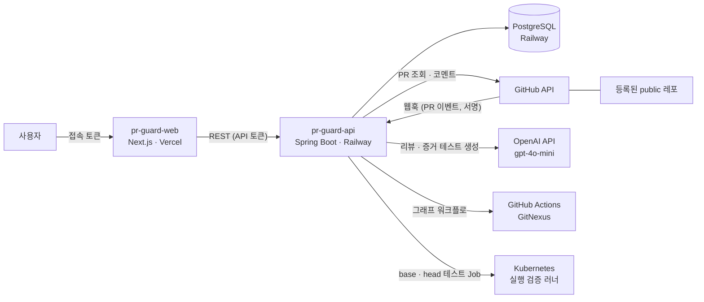

# 🛡️ PR Guard

**AI 네이티브 개발 환경에서, 속도는 그대로 두고 코드 품질을 지키는 PR 검증 계층**

동국대학교 창의융합경진대회 2026

> AI 가 코드를 쓰는 속도로 리뷰하고, 사람은 **증명된 위험**만 본다.

---

## 왜 만드나

AI 코딩 에이전트를 쓰면 PR 은 많아지고 커지는데, 사람이 리뷰할 수 있는 시간은 그대로입니다. 리뷰가 병목이 되고, 결국 "대충 보고 머지" 가 늘어납니다.

AI 가 쓴 코드는 그럴듯해 보이지만 이런 문제가 자주 섞여 들어옵니다.

- 요청하지 않은 변경, 빠진 구현
- 기존 동작을 **조용히** 바꾸는 수정 (예: 예외를 던지던 곳이 `null` 을 반환)
- 레포 맥락을 모른 채 고쳐서 깨지는 호출부, 늘 함께 바뀌던 파일의 누락
- 기존 테스트가 **한 번도 지나가지 않는** 곳의 변경

"AI 로 리뷰한다" 는 이제 흔합니다. PR Guard 는 **AI 의 말을 그대로 믿지 않고, 정적 분석 · 이력 통계 · 실제 실행으로 근거를 만든 뒤** 판정합니다. LLM 은 그 근거를 해석하는 역할만 맡습니다.

## AI 환경의 문제 → PR Guard 가 하는 일

| AI 환경에서 생기는 문제 | PR Guard | 근거를 만드는 방법 |
|---|---|---|
| 변경이 어디까지 번지는지 사람이 다 못 봄 | **영향 범위 시각화** | 함수 단위 호출 그래프에서 바뀐 함수 → 직접 · 간접 호출부 |
| AI 가 기존 동작을 몰래 바꿈 | **실행으로 증명** | 증거 테스트: base 에서 통과하고 head 에서 실패하는 테스트를 만들어 실제로 돌림 |
| 기존 테스트가 깨지는지 모름 | **실행 검증** | 쿠버네티스 Pod 에서 base · head 테스트를 돌려 회귀 비교 |
| 테스트가 실제로 그 코드를 지키는지 모름 | **런타임 트레이스** | 테스트 중 실제 호출을 기록해 바뀐 메서드를 지나간 테스트를 찾음 |
| 테스트가 통과해도 실제로 버그를 잡는지 모름 · AI 가 테스트를 통과시키려고 테스트를 고침 | **테스트 신뢰도** | 바뀐 메서드에 작은 버그를 심어(변이 테스트) 테스트가 잡는지 실행으로 확인, 다시 돌리면 통과하는 flaky 판별, 테스트 약화(검증하던 테스트 삭제 · 실패 경로 검증 제거 · @Disabled) 정적 검사 |
| PR 마다 전체 테스트를 돌리면 느리고 비쌈 | **영향 테스트 선택** | 전체 실행 기록(테스트 → 지나간 메서드)과 호출 그래프로 바뀐 코드를 지나가는 테스트만 실행. 영향 범위를 확정할 수 없으면 전체 실행 |
| 레포 맥락 · 관행을 모르는 코드 | **이력 기반 경고** | git 동시 변경 통계, 핫스팟, 숨은 결합 |
| 프로젝트 구조를 거스르는 코드 | **구조 변화 검사** | PR 전후 코드 인덱스의 파일 간 의존 비교: 계층 건너뜀 · 역방향 의존 · 새 모듈 의존 |
| 비밀값 · 권한 검사 누락 | **보안 검사** | 추가된 줄의 비밀값(알려진 키 형식 · 비밀값 이름), 사라진 권한 어노테이션 |
| 리뷰어 시간 부족 | **판정 + 근거 요약** | 규칙으로 계산한 판정, PR 코멘트, 단계별 파이프라인 화면 |

## 동작 방식

```
public 레포 URL 등록 → 온보딩 (GitNexus 코드 그래프 · 레포 브리핑)
        ↓
PR 감지 (웹훅으로 즉시 · 5분 폴링이 놓친 것을 메움)
        ↓
base / head 소스 인덱스 → 바뀐 메서드 · 호출부 · git 이력
        ↓
 ┌ 정적 검사  B. 변경 영향 (참조 · AST 동작 패턴)   C. 보안 (권한 · 비밀값)   D. 구조 변화
 ├ LLM 리뷰   (위 근거를 함께 전달)
 └ 실행 검증  영향 있는 테스트만 골라 쿠버네티스 Pod 에서 base · head 빌드 · 테스트
              + 증거 테스트 (동작 변화 증명) + 런타임 호출 기록
              + 변경분 변이 테스트 (심은 버그를 테스트가 잡나) + flaky 재실행
        ↓
판정 (머지 가능 / 수정 후 머지 / 머지 비권장) → PR 코멘트
```

- **이번 PR 이 새로 만든 문제만** 보고합니다 (base 에도 있던 문제는 뺌).
- 판정은 LLM 이 아니라 규칙이 계산합니다 (BLOCKER ≥ 1 → 머지 비권장, MAJOR ≥ 1 → 수정 후 머지).

## 기능 명세

상태: ✅ 운영 중 · 🧪 구현 완료, 운영에서는 꺼짐 (minikube 에서 검증) · 🚧 준비 중

### 1. 프로젝트 등록 · 온보딩

| 기능 | 설명 | 상태 |
|---|---|---|
| 레포 등록 | public GitHub 레포 URL 을 받아 확인 · 저장. 등록하면 코드 그래프 분석이 시작된다 | ✅ |
| 온보딩 5단계 | 레포 확인 → 분석 진행(실시간) → 레포 브리핑 → 리뷰 설정 → 첫 리뷰 | ✅ |
| 레포 브리핑 | 기능 묶음, 많이 쓰이는 파일, 많이 호출되는 함수, 실행 시작점, 레이어, 테스트 현황 | ✅ |
| 프로젝트 설정 | PR 코멘트 on/off, "수정 후 머지" 판정 기준(MAJOR 개수), 실행 검증 on/off | ✅ |
| 접근 제어 | 사이트 입구의 접속 토큰 입력(30일 유지 · 로그아웃). 백엔드는 화면 서버만 부를 수 있게 API 토큰으로 막음 (웹훅 · 러너 · 그래프 콜백은 각자 서명 · 일회용 토큰으로 확인) | ✅ |

### 2. PR 감지 · 리뷰 실행

| 기능 | 설명 | 상태 |
|---|---|---|
| 웹훅 | PR 이 열리거나 커밋이 올라오면 바로 리뷰 시작 (GitHub 서명 HMAC-SHA256 확인, 닫히면 닫힘으로) | ✅ |
| 폴링 | 5분마다 열린 PR 조회 (ETag 로 변경 없으면 비용 없음). 웹훅을 달 수 없는 레포 · 놓친 이벤트를 메움 | ✅ |
| 수동 실행 | 지금 확인, PR 다시 리뷰 | ✅ |
| 소스 준비 | 레포 clone → base(merge-base) · head worktree. 실패하면 diff 만으로 계속 | ✅ |

### 3. 분석 · 검사

| 기능 | 설명 | 상태 |
|---|---|---|
| 레포 인덱스 · 메서드 비교 | base · head Java 소스의 타입 · 메서드 · 호출 관계 → 추가 · 삭제 · 시그니처 변경 · 본문 변경 | ✅ |
| git 이력 | 늘 함께 바뀐 파일(동시 변경), 바뀐 라인의 원래 커밋(blame) | ✅ |
| B. 변경 영향 (참조 검사) | 옛 시그니처로 부르는 호출부, 사라진 메서드 호출. base 에도 있던 문제는 제외 | ✅ |
| B. 변경 영향 (AST 동작 패턴) | AST diff: 예외 → null 반환, null 검사 삭제, 빈 catch, 예외 경로 삭제 | ✅ |
| C. 보안 | 권한 어노테이션 삭제(BLOCKER), 추가된 줄의 비밀값: 알려진 키 형식(BLOCKER) · 비밀값 이름의 상수 · 설정(MAJOR) | ✅ |
| D. 테스트 신뢰도 (정적) | 이번 PR 이 바꾼 테스트: 검증하던 테스트 삭제(그 코드는 남음) · 실패 경로 검증 감소 · @Disabled 추가 → MAJOR, 검증 없음 · 항상 참인 검증 · 예외 삼킴 → MINOR. 평가 PR #18(테스트 약화)을 잡고 정상 PR 에서는 지적 없음 | ✅ |
| D. 구조 변화 | 이번 PR 이 만든 파일 간 의존 중 계층 건너뜀(프로젝트가 평소 서비스를 거칠 때만) · 역방향 의존 · 새 모듈 의존 | ✅ |
| LLM 리뷰 | 위 근거를 함께 넘겨 리뷰 (OpenAI, JSON 스키마). 변경 파일 밖을 가리킨 지적은 버림. 보안이라고 한 지적은 C 로 분류 | ✅ |
| A. 의도 대비 (결정적 검사) | 지금은 LLM 리뷰가 대신함 | 🚧 |

### 4. 실행 검증 (쿠버네티스)

| 기능 | 설명 | 상태 |
|---|---|---|
| base · head 테스트 실행 | PR 마다 Job 2개. 권한 없는 러너, 일회용 토큰으로만 결과 보고 | 🧪 |
| 변경분 변이 테스트 | 바뀐 메서드에 PIT 로 작은 버그(조건 반전 · null 반환 · 호출 삭제 …)를 심고 고른 테스트로 돌림. 지나가는 테스트가 있는데 하나도 못 잡으면 MAJOR "가짜 안전", 일부 놓치면 MINOR. 어떤 버그를 어느 테스트가 막았는지 메서드 단위로 | 🧪 |
| flaky 판별 | 실패한 테스트 클래스만 다시 돌려, 다시 통과하면 flaky 로 보고 회귀(BLOCKER)에서 뺌 | 🧪 |
| 영향 테스트 선택 | 바뀐 메서드를 지나가는 테스트 클래스만 base · head 에서 똑같이 실행 (기준 = 전체 실행의 호출 기록 + 호출 그래프). 바뀐 테스트 · 기록에 없는 테스트는 늘 실행. 빌드 · 설정 · 메서드 밖 변경 등은 이유를 남기고 전체 실행. 그림자 모드로 "걸렀다면 놓쳤을 실패"를 확인 | 🧪 |
| 회귀 비교 | base 에서 통과하던 테스트가 head 에서 실패 → BLOCKER, 새 테스트 실패 → MAJOR | 🧪 |
| 증거 테스트 | 본문만 바뀐 메서드마다 "base 통과 · head 실패" 테스트를 LLM 으로 생성해 함께 실행 → 동작 변화를 증명하면 MAJOR | 🧪 |
| 런타임 트레이스 | 테스트 중 실제 호출 기록 → 바뀐 메서드를 지나간 테스트, 한 번도 실행되지 않은 변경은 MINOR | 🧪 |
| 동작 diff | 관측 테스트가 바뀐 메서드를 여러 입력으로 불러 base · head 결과를 입력별로 맞댐 ("getPost(999): NotFoundException → null"). 리뷰 화면 맨 위에 표로 | 🧪 |

### 5. 판정 · PR 코멘트

| 기능 | 설명 | 상태 |
|---|---|---|
| 근거 확인 | 지적마다 코드 인덱스 · git 이력 · 실행 · AI 층이 각각 확인했는지 판단하고 근거 한 줄을 남김. AI 가 "없다"고 한 이름이 head 에 있으면 판정에서 뺌 | ✅ |
| 판정 | 규칙으로 계산: BLOCKER ≥ 1 → 머지 비권장, MAJOR ≥ 기준 → 수정 후 머지, 그 외 머지 가능 | ✅ |
| PR 코멘트 | 요약 코멘트 1개(다시 리뷰하면 고침) + 라인 코멘트(같은 지적은 한 번만) | ✅ |

### 6. 화면

| 기능 | 설명 | 상태 |
|---|---|---|
| 입구 코드 시티 | 프로젝트 화면 전체에 코드 시티(구역 = 모듈 · 계층)를 깔고 사람이 볼 PR 이 바꾼 건물을 판정 색으로 세움 | ✅ |
| 리뷰 장면 | 리뷰 단계 기록을 도시 위 장면으로: AI 리뷰어 로봇이 바뀐 건물을 스캔 → 영향 · 숨은 결합 케이블 · 구조 변화 다리 → 보안 지적이 있으면 하늘의 해커 홀로그램이 그 건물을 노림 → 근거 층이 떠올라 지적 핀 관통, 확인된 위협은 방어막 → 판정. 진행 중이면 실시간, 끝난 리뷰는 다시 보기 | ✅ |
| 실행 검증 미리보기 | 평행 도시: PR 전 도시가 하늘에 거꾸로 매달리고 깨진 테스트로 번개. 실행 검증이 꺼져 있어 예시 데이터로 표시 | 🧪 (예시 데이터) |
| 커밋 그래프 | 모든 브랜치의 최근 커밋을 갈래 · 병합 레인으로. 열린 PR 의 브랜치는 그 PR 판단 화면으로 | ✅ |
| 리뷰 파이프라인 | 단계가 실시간으로 켜지는 그래프, 다시보기(1×/2×/4×), 단계별 결과물, 실행 검증 레인 · 증거 테스트 판정 | ✅ |
| 테스트 선택 장면 | 테스트 무더기 → 바뀐 메서드가 켜짐 → 영향 있는 테스트만 실행 열로 모이고 나머지는 꺼짐 → 선이 뻗고 실행 중인 테스트가 빛남 → 통과 · 회귀 → 심은 버그가 날아가 테스트가 막으면 방어막, 못 막으면 뚫고 "놓친 버그" 칸으로. 테스트 신뢰도(변이 점수 · 메서드별 막은 / 놓친 버그 · flaky · 약화), 실행 · 걸러진 테스트와 이유, 아낀 시간 | 🧪 (실행 검증 기록이 있어야 보임) |
| PR 영향 그래프 · 3D 영향 시티 | 바뀐 함수 → 직접 → 간접 호출부로 영향이 퍼지는 모습 | ✅ |
| 코드 그래프 | GitNexus(GitHub Actions)로 만든 함수 단위 그래프. 점 = 함수, 상자 = 파일, 색 = 코드 시티와 같은 구조 구역, 검색 | ✅ |
| 코드 인사이트 | 3D 코드 시티(시간 여행 · 호출 호 · 인프라 층), 핫스팟 트리맵, 숨은 결합 | ✅ |
| 런타임 오버레이 | 그래프 · 시티에 실제로 불린 함수 열지도, 흐르는 호출, 정적 분석이 놓친 호출 | 🧪 (실행 검증 기록이 있어야 보임) |
| 근거 층 | 지적마다 어느 층이 확인했는지 3D 로 펼침: 아래에서 위로 인덱스 · 이력 · 실행 · AI 층, 지적 핀이 확인한 층까지 관통. "여러 층이 확인" · "AI 만 주장" 으로 묶어 사람은 "AI 만 주장" 부터 확인 | ✅ |
| AI 위임 지도 | 파일마다 맡겨도 됨 · 맡기되 리뷰 필수 · 사람이 직접 구역과 이유 (보안 경로 · 테스트 관계 · 핫스팟 · 숨은 결합 · 의존도). 코드 시티 색 기준, 리뷰 화면에 PR 이 건드린 구역 카드 | ✅ |

### 7. AI 에이전트 규칙 (AGENTS.md)

| 기능 | 설명 | 상태 |
|---|---|---|
| 규칙 파일 확인 | 레포의 AGENTS.md · CLAUDE.md · copilot-instructions.md · .cursorrules 유무와 내용 | ✅ |
| 초안 생성 | 빌드 · 테스트 명령, 구조, 조심할 곳(핫스팟 · 많이 쓰이는 파일), 함께 바뀌어야 하는 파일, AI 작업 구역, 테스트 · PR 규칙 | ✅ |
| 반복된 실수 → 규칙 (피드백 루프) | 리뷰 지적을 실수 유형 12가지로 묶고, 여러 PR 에서 반복된 유형을 규칙으로 제안 | ✅ |
| PR 로 제안 | 초안 · 갱신안을 대상 레포에 PR 로 올림 (직접 push 하지 않음) | ✅ |

### 8. 평가

sandbox 평가 PR 23개 (문제 PR 16개 · 정답 지적 20개 · 정상 PR 7개). 문제 PR 은 AI 가 쓴 코드에서 자주 보이는 실수 유형으로 만들었고, #10~#24 의 문제 PR 은 모두 **컴파일되고 기존 테스트를 통과한다** — 테스트 통과만으로는 머지 여부를 판단할 수 없는 PR 들이다.

같은 세트를 근거 확인 도입 뒤 다시 리뷰한 결과. LLM 이 회차마다 다른 지적을 내므로 여러 회는 범위로 적는다. 리뷰 모델에 따라 결과가 크게 다르다.

| 항목 | gpt-5-mini (3회) | gpt-4o-mini (1회, 지금 기본값) |
|---|---|---|
| 문제 탐지 | **18 ~ 19 / 20** | 7 / 20 |
| 판정 적절 | **20 ~ 23 / 23** | 14 / 23 |
| 문제 PR 을 "머지 가능"으로 흘림 | **0 ~ 1 / 16** | 3 / 16 |
| 정상 PR 자동 통과 (사람이 깊게 안 봐도 되는 PR) | **5 ~ 7 / 7** | 1 / 7 |
| 리뷰 소요 시간 | 중앙값 17 ~ 20초 · 최대 46초 | 중앙값 7초 · 최대 10초 |

gpt-4o-mini 회차는 비밀값 · 구조 변화 검사를 더한 뒤에 쟀다. 두 검사는 평가 세트에서 PR #8 의 비밀값 하드코딩(정답 지적)과 PR #14 의 계층 건너뜀 두 건만 잡았고, 정상 PR 에서는 지적이 없었다. gpt-4o-mini 회차의 하락은 LLM 지적의 차이다 (정상 PR 의 MAJOR 오탐, 문제 PR 의 놓침).

3회 동안 정상 PR 에서 나온 BLOCKER/MAJOR 오탐 5건 중 4건은 근거 층의 "AI 만 주장" 묶음에 들어갔다 (인덱스 · 실행 층은 확인하지 않음). 나머지 1건("테스트가 save 호출을 검증하지 않음")은 인덱스가 사실만 확인한 것을 "확인"으로 친 경우라, 지금은 "AI 만 주장"으로 분류하도록 고쳤다.

AI 실수 유형별 탐지 (gpt-5-mini): 요청하지 않은 변경 2/2 · 빠진 구현 2/2 · 조용한 동작 변경 4/4 · 깨지는 호출부 1/2 · 보안 회귀 5/5 · 스키마 불일치 2/2 · 환각 의존성 1/1 · 레포 맥락 무시 1/1 · 테스트 약화 1/1

diff 만 LLM 에 넣은 기준선과 비교 (#2~#9):

| 항목 | 기준선 | PR Guard |
|---|---|---|
| 문제 탐지 | 7 / 10 | **9 / 10** |
| 판정 적절 | 7 / 8 | **8 / 8** |
| 정상 PR 자동 통과 | 0 / 1 | **1 / 1** |

`pr-guard-api/eval` 의 정답표와 채점 스크립트로 잰다.

## 인프라 구조



| 구성 | 위치 | 역할 |
|---|---|---|
| 프론트엔드 | Vercel | 레포 등록, 리뷰 · 그래프 · 인사이트 화면. 접속 토큰을 넣어야 들어온다. 백엔드는 서버에서만 호출 |
| 백엔드 | Railway | PR 웹훅 · 폴링, 분석 파이프라인, 판정, PR 코멘트. 화면 서버가 보낸 API 토큰이 있어야 받는다 |
| DB | Railway PostgreSQL | 프로젝트 · PR · 리뷰 · 실행 기록. 백엔드만 내부망으로 접속 |
| 코드 그래프 | GitHub Actions | GitNexus 로 레포 인덱싱 (메모리가 커서 서버 밖에서 실행) |
| 실행 검증 | Kubernetes | PR 마다 base · head Job. 영향 있는 테스트만 실행. 권한 없는 러너, 일회용 토큰으로만 결과 보고 |
| 외부 API | GitHub, OpenAI | PR · diff 조회와 코멘트 / LLM 리뷰 · 증거 테스트 생성 |

> 실행 검증은 쿠버네티스 연결을 켠 환경에서 동작합니다. 현재 공개 서비스에서는 꺼져 있고, minikube 환경에서 검증했습니다.

### 실행 검증 실측 (minikube)

`demo-petclinic` PR #1 을 전체 실행으로 한 번(기준 기록을 만듦), 영향 테스트 선택으로 한 번 리뷰했습니다.

| | 전체 실행 | 영향 테스트 선택 |
|---|---|---|
| 테스트 클래스 · 케이스 | 18 · 81 | **4 · 24** |
| 찾은 회귀 | 2 | **2 (같은 것, 놓친 것 없음)** |
| 변경분 변이 테스트 | 11개 심어 11개 잡음 | 11개 심어 11개 잡음 |
| 판정 | 머지 비권장 | 머지 비권장 |

sandbox PR #18(테스트 약화)은 정적 검사가 "검증하던 테스트가 사라짐(실패 경로 검증 포함)"으로 잡고, 같은 PR 을 지우기 전 코드에 변이 테스트를 돌리면 "권한 검사 호출 삭제" 버그를 막는 테스트가 바로 그 지운 테스트 하나뿐이었습니다.

## 레포지토리

| 레포 | 설명 |
|---|---|
| [pr-guard-api](https://github.com/dongguk-creative-fusion-2026/pr-guard-api) | 백엔드 — PR 웹훅 · 폴링, 분석 파이프라인, 실행 검증 · 영향 테스트 선택, 리뷰 코멘트 (Spring Boot) |
| [pr-guard-web](https://github.com/dongguk-creative-fusion-2026/pr-guard-web) | 프론트엔드 — 리뷰 파이프라인, 테스트 선택 장면, 코드 그래프, 코드 인사이트 (Next.js) |
| [pr-guard-sandbox](https://github.com/dongguk-creative-fusion-2026/pr-guard-sandbox) | 테스트 · 평가용 레포 (평가 PR #1~#24) |
| [demo-petclinic](https://github.com/dongguk-creative-fusion-2026/demo-petclinic) | 커밋 이력이 긴 시연용 레포 |

## 바로 보기

- 서비스: https://pr-guard-web.vercel.app (접속 토큰 필요 · 팀에 문의)
- 리뷰 예시: [pr-guard-sandbox PR #1](https://github.com/dongguk-creative-fusion-2026/pr-guard-sandbox/pull/1)
